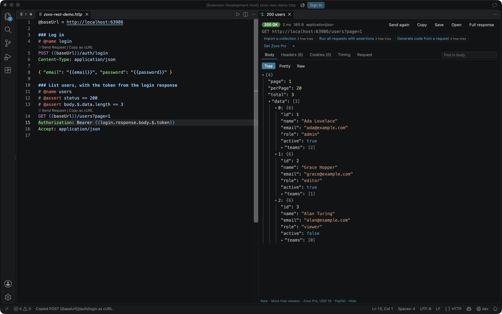

# REST Client & HTTP Client for VS Code (no login)

Send HTTP requests from plain `.http` and `.rest` files and read the response right beside them. There is no account, no sign-in and no cloud sync. Your requests live in your repo as text, so you can review and share them like code.



## Free, with no limits

- Send Request link above every request, or Ctrl+Alt+R (Cmd+Alt+R on macOS) with the cursor in it.
- Response viewer: status, time and size; the body as a collapsible JSON tree, pretty or raw; XML and HTML source; images; headers, cookies, a timing breakdown (DNS, TCP, TLS, waiting, download) and the request that was actually sent. Find in body, copy any value with a click, save the body to a file.
- Variables and environments: `@baseUrl = ...` in the file, environments in `http-client.env.json` or settings, `$shared` values, `{{$guid}}`, `{{$timestamp}}`, `{{$randomInt}}`, `{{$datetime}}`, `{{$processEnv}}` and `{{$dotenv}}`. Switch with Ctrl+Alt+E. Hover a variable to see its value, with secrets masked.
- Chained requests: name a request with `# @name login` and use `{{login.response.body.$.token}}` or a response header in the next one. If you have not sent `login` yet, it is sent first.
- cURL both ways: paste a cURL command from browser DevTools as a request, or copy any request as cURL with its variables filled in.
- GraphQL (`X-Request-Type: GraphQL`), form bodies, Basic auth written as `user password`, body from a file (`< ./body.json`), cookies kept for the session, redirects followed, gzip and brotli decoded.
- History of the last 50 requests, stored as written, without your secret values.

## Pro tools

Zovo Pro: USD 19 once. One purchase turns on the Pro tools in every Zovo extension. Each tool here has 3 free tries first:

- Import a collection: a collection export in the common v2.x collection format (with its environments), a v4 workspace export or an OpenAPI / Swagger file becomes a `.http` file plus `http-client.env.json`.
- Run all requests with assertions: run a file or a whole folder in order with `# @assert status == 200` style checks, and get a JUnit XML file for CI plus an HTML report.
- Generate code from a request: JavaScript fetch, Node axios, Python requests, Go, C#, Java, PowerShell or cURL.

## Quick start

1. Create a file named `api.http` (or run REST Client (Zovo): New .http File).
2. Write a request and click Send Request above it:

```http
@baseUrl = https://jsonplaceholder.typicode.com

### List posts
# @name posts
GET {{baseUrl}}/posts?userId=1
Accept: application/json

### Read the first one
GET {{baseUrl}}/posts/{{posts.response.body.$[0].id}}

### Create one
POST {{baseUrl}}/posts
Content-Type: application/json

{ "title": "hello", "userId": 1 }
```

Requests are separated by lines that start with `###`. Headers follow the request line; the body comes after one empty line.

## File format

| You write | What it does |
|---|---|
| `GET https://host/path HTTP/1.1` | Request line. The method defaults to GET, the HTTP version is optional. |
| `    ?page=2` and `    &size=50` | Query lines that continue the URL. |
| `Name: value` | A header, up to the first empty line. |
| `< ./payload.json` | Send a file as the body. `<@ ./payload.json` also fills `{{variables}}` in it. |
| `@name = value` | A file variable. |
| `# @name login` | Names the request so others can use its response. |
| `# @no-redirect`, `# @no-cookie-jar`, `# @timeout 5000` | Per-request options. |
| `# @assert status == 200` | A check for Run all requests (Pro). Also `time < 500`, `header Content-Type contains json`, `body.$.items.length > 0`, `body.$.id exists`, `body matches /ok/`. |

## Environments

`http-client.env.json` next to your `.http` files (or in a parent folder):

```json
{
  "$shared": { "version": "v2" },
  "dev":  { "baseUrl": "http://localhost:3000", "token": "dev-token" },
  "prod": { "baseUrl": "https://api.example.com" }
}
```

Put secrets in `http-client.private.env.json` and keep that file out of git. The setting `zovoRest.environmentVariables` holds environments too.

## Commands

| Command | Keys |
|---|---|
| REST Client (Zovo): Send Request | Ctrl+Alt+R / Cmd+Alt+R |
| REST Client (Zovo): Send Last Request Again | Ctrl+Alt+L / Cmd+Alt+L |
| REST Client (Zovo): Cancel Request | Ctrl+Alt+K / Cmd+Alt+K |
| REST Client (Zovo): Switch Environment | Ctrl+Alt+E / Cmd+Alt+E |
| REST Client (Zovo): Copy Request as cURL, Paste cURL as Request | |
| REST Client (Zovo): Request History, Clear Request History, Clear Cookies | |

## Privacy

The extension sends only the requests you send. It has no telemetry, no account and no update check of its own. Cookies stay in memory for the window. History keeps requests as you wrote them, so values from environments and `.env` files are not stored.

## Limits in this version

- No proxy support yet: requests go out directly, not through `http.proxy`.
- No client certificates (mTLS) and no NTLM, Digest or AWS signature auth. Bearer, Basic and API key headers work.
- Response handler scripts (`> `) are not run. Use `# @assert` lines with Run all requests.
- HTML responses show as source, not as a rendered page.
- One request at a time per window; sending a new one cancels the one in flight.

## Support Zovo

Zovo Pro: USD 19 once, every Zovo viewer. [Get Zovo Pro on GitHub Sponsors](https://github.com/sponsors/theluckystrike/sponsorships?tier_id=679878) to turn on the Pro tools in this extension and in the other Zovo extensions you use. The free features stay free.

Zovo extensions have no ads and no tracking. They are made by [theluckystrike](https://github.com/theluckystrike) on GitHub. You can also support the work with no Pro:

- [Sponsor on GitHub](https://github.com/sponsors/theluckystrike)
- [PayPal](https://www.paypal.com/paypalme/najzzz)
- [Follow theluckystrike on GitHub](https://github.com/theluckystrike)

### Need your format supported?

Open a [format request](https://github.com/theluckystrike/rest-client-vscode/issues/new?template=format-request.yml) with a sample file, and I reply there whether it can be done. For USD 299 once, through [this GitHub Sponsors tier](https://github.com/sponsors/theluckystrike/sponsorships?tier_id=679995), I add your file format or a missing feature to this extension, with tests, within 7 days.

## More tools by Zovo

- [PDF Viewer & PDF Reader to Read and View PDF (Dark Mode)](https://marketplace.visualstudio.com/items?itemName=zovo.pdf-viewer-dark) reads PDFs with a real dark mode, search, an outline and thumbnails.
- [XLSX Viewer, Excel Viewer, CSV Viewer & Parquet Viewer (XLS, CSV Preview)](https://marketplace.visualstudio.com/items?itemName=zovo.table-viewer-vscode) opens CSV, TSV, Excel and Parquet files as a sortable, filterable table.
- [DOCX Viewer & ODT Viewer, Word Document Preview (Dark Mode)](https://marketplace.visualstudio.com/items?itemName=zovo.docx-viewer-vscode) previews Word and ODT files with dark mode, an outline and search.

See [all Zovo extensions on the Marketplace](https://marketplace.visualstudio.com/publishers/zovo).
